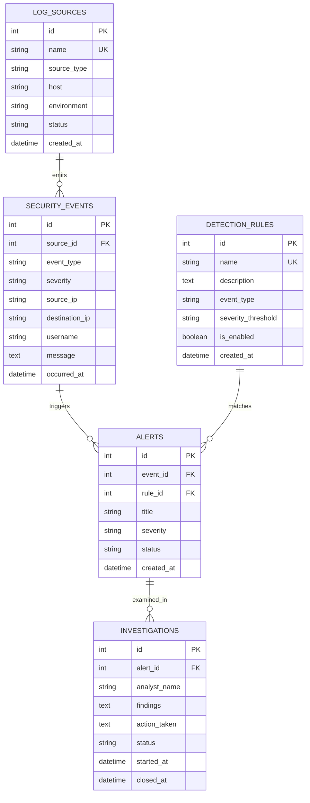

# ERD CyberSOC API

## Penjelasan relasi
- `log_sources.id` adalah PK; `name` unik. Satu sumber log menghasilkan banyak security event.
- `security_events.source_id` adalah FK ke `log_sources.id`.
- `detection_rules.id` adalah PK; `name` unik. Satu aturan deteksi dapat menghasilkan banyak alert.
- `alerts.event_id` dan `alerts.rule_id` adalah FK ke `security_events.id` dan `detection_rules.id`.
- `investigations.alert_id` adalah FK ke `alerts.id`. Satu alert dapat memiliki beberapa catatan investigasi.
- Penghapusan sumber log/event/aturan/alert yang masih direferensikan dicegah oleh integritas FK dan relasi.
